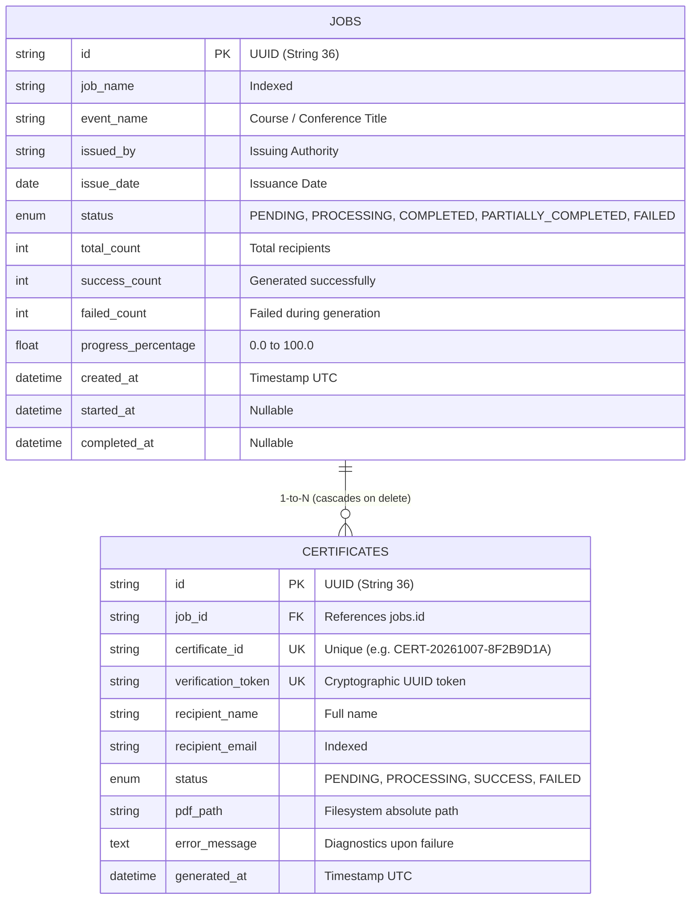

# 🎓 Bulk Certificate Generator

[](https://fastapi.tiangolo.com)
[](https://www.python.org/)
[](https://www.postgresql.org/)
[](https://www.sqlalchemy.org/)
[](https://pytest.org/)

> **A production-inspired, highly resilient backend engine for generating, verifying, and distributing bulk PDF certificates with dynamic tamper-evident QR codes and fault-isolated asynchronous execution.**

---

## 📑 Table of Contents
1. [Executive Overview](#-executive-overview)
2. [Architectural Highlights](#-architectural-highlights)
3. [System Architecture & Flow](#-system-architecture--flow)
4. [Database Design](#-database-design)
5. [API Specification](#-api-specification)
6. [Failure Isolation & Resilience](#-failure-isolation--resilience)
7. [QR Code Verification Engine](#-qr-code-verification-engine)
8. [Getting Started (Local & Docker)](#-getting-started)
9. [Running Automated Tests](#-running-automated-tests)
10. [Design Decisions & Trade-Offs](#-design-decisions--trade-offs)
11. [Scalability & Production Roadmap](#-scalability--production-roadmap)
12. [Interview Guide & Talking Points](#-interview-guide--talking-points)

---

## 🌟 Executive Overview

Organizations regularly conduct bootcamps, workshops, exams, and conferences where hundreds or thousands of attendees require verifiable completion certificates. 

A naive backend implementation performs synchronous PDF rendering inside request threads, leading to:
- HTTP timeouts (gateway 504 errors)
- Cascade crashes: a single formatting error or typo aborts the entire batch
- Unverifiable documents: static PDFs susceptible to counterfeiting
- Unresponsive client interfaces with zero feedback

**Bulk Certificate Generator** solves these problems with:
- **FastAPI Asynchronous Queueing (`BackgroundTasks`)**: Returns HTTP `202 Accepted` in milliseconds while delegating PDF composition to background worker execution.
- **Strict Failure Isolation**: Recipient generation errors are isolated in a local `try/except` block—meaning recipient 2 failing will never abort recipient 3.
- **Granular Real-Time Progress Tracking**: Progress percentage, success count, and failure count are committed transactionally to PostgreSQL for live client polling.
- **Tamper-Evident QR Code Verification**: Each certificate embeds an scannable QR code directing to an official authenticity verification API endpoint.
- **Single & Bulk ZIP Retrieval**: Endpoints for downloading individual PDF files or an on-the-fly compressed ZIP archive of all successful certificates.
- **Zero Unnecessary Infrastructure**: Eliminates Celery, Redis, and message broker operational overhead while maintaining a clean migration path.

---

## 🏛 System Architecture & Flow

```
[ Client Application ]
        │
   1. POST /api/v1/jobs (JSON Payload: Event Details + Recipients)
        ▼
┌────────────────────────────────────────────────────────┐
│ FastAPI Request Pipeline                               │
│  - Pydantic v2 Schema & Email Validation               │
│  - Atomic Job & Certificate Creation in DB (PENDING)    │
│  - Enqueue process_job_background()                    │
└────────────────────────────────────────────────────────┘
        │
   2. Returns HTTP 202 Accepted { job_id, status: "PENDING", total_count }
        │
        ▼ (Asynchronous Execution)
┌────────────────────────────────────────────────────────┐
│ Background Processing Worker                           │
│  - Open dedicated DB Session                           │
│  - Update Job Status -> PROCESSING                     │
│  - Loop Recipients:                                    │
│    ┌───────────────────────────────────────────────┐   │
│    │ try:                                          │   │
│    │   1. Generate QR Code with Verification URL   │   │
│    │   2. Render Vector PDF via ReportLab (A4 Land)│   │
│    │   3. Save to generated/{job_id}/{cert_id}.pdf │   │
│    │   4. Mark cert SUCCESS, increment success_cnt │   │
│    │ except Exception as err:                      │   │
│    │   1. Mark cert FAILED, record error_message   │   │
│    │   2. Increment failed_count                   │   │
│    │ finally:                                      │   │
│    │   Calculate progress_percentage & DB Commit   │   │
│    └───────────────────────────────────────────────┘   │
│  - Compute Final Job Status:                           │
│    (COMPLETED / PARTIALLY_COMPLETED / FAILED)          │
│  - Set completed_at & Final DB Commit                  │
└────────────────────────────────────────────────────────┘
```

---

## 🗄 Database Design

Relational data model implemented with PostgreSQL and SQLAlchemy 2.0.

### Entity Relationship Diagram (ERD)



---

## 🔌 API Specification

Interactive Swagger UI documentation is available at **`/docs`** and ReDoc at **`/redoc`**.

| Method | Endpoint | Description | Status Code |
| :--- | :--- | :--- | :--- |
| `POST` | `/api/v1/jobs` | Submit a batch of recipients for certificate generation | `202 Accepted` |
| `GET` | `/api/v1/jobs/{job_id}` | Poll job status, progress percentage, and counts | `200 OK` |
| `GET` | `/api/v1/jobs/{job_id}/certificates` | List certificates with optional status filtering (`?status=SUCCESS`) and pagination | `200 OK` |
| `GET` | `/api/v1/jobs/{job_id}/download` | Download ZIP archive containing all successful certificates | `200 OK` |
| `GET` | `/api/v1/certificates/{certificate_id}` | Retrieve individual certificate metadata and download link | `200 OK` |
| `GET` | `/api/v1/certificates/{certificate_id}/download` | Stream the individual PDF file for direct download | `200 OK` |
| `GET` | `/api/v1/verify/{certificate_id}` | Validate credential authenticity and view verified recipient data | `200 OK` |
| `GET` | `/api/v1/dashboard/stats` | High-level system statistics (totals, success rate, status breakdown) | `200 OK` |
| `GET` | `/health` | Health check probe (verifies database & storage availability) | `200 OK` |

### Sample Payload: `POST /api/v1/jobs`

```json
{
  "job_name": "Distributed Systems Masterclass 2026",
  "event_name": "Advanced Python & Resilient Backend Engineering",
  "issued_by": "DeepMind Academy",
  "issue_date": "2026-10-07",
  "recipients": [
    {
      "recipient_name": "Alice Johnson",
      "recipient_email": "alice@example.com"
    },
    {
      "recipient_name": "Bob Smith",
      "recipient_email": "bob@example.com"
    }
  ]
}
```

### Response: `202 Accepted`
```json
{
  "job_id": "8f68e0d9-52e6-4299-8e41-0570a27e770b",
  "status": "PENDING",
  "total_count": 2,
  "message": "Bulk certificate generation job accepted and processing in background."
}
```

---

## 🛡 Failure Isolation & Resilience

In production environments, external factors (unsupported font glyphs, disk I/O errors, memory constraints, corrupt inputs) can trigger unexpected exceptions.

Our system enforces **strict fault boundaries**:

```python
for cert in certificates:
    try:
        # 1. Render certificate PDF
        CertificateGenerator.generate_pdf(...)
        cert.status = CertificateStatus.SUCCESS
        success_count += 1
    except Exception as exc:
        # 2. Failure isolated: Remaining recipients continue unimpeded!
        cert.status = CertificateStatus.FAILED
        cert.error_message = str(exc)
        failed_count += 1
    
    # 3. Transactional progress persistence
    job.progress_percentage = round(((success_count + failed_count) / total) * 100, 2)
    db.commit()
```

### Resulting Job State Matrix:
- If `failed_count == 0`: Status **`COMPLETED`**
- If `success_count > 0 and failed_count > 0`: Status **`PARTIALLY_COMPLETED`**
- If `success_count == 0`: Status **`FAILED`**

---

## 🔍 QR Code Verification Engine

Every certificate includes:
1. A unique, human-readable **Certificate ID** (`CERT-YYYYMMDD-HEX`).
2. An embedded **QR Code** pointing to the verification endpoint:
   `http://<domain>/api/v1/verify/{certificate_id}`
3. When scanned with any standard smartphone camera or QR reader, it opens the verification endpoint.

### Verification Response:
```json
{
  "valid": true,
  "certificate_id": "CERT-20261007-8F2B9D1A",
  "recipient": "Alice Johnson",
  "event": "Advanced Python & Resilient Backend Engineering",
  "issue_date": "2026-10-07",
  "issued_by": "DeepMind Academy",
  "status": "AUTHENTIC & VALID",
  "generated_at": "2026-10-07T11:45:12.304000+00:00",
  "verification_token": "a1b2c3d4e5...",
  "message": "This certificate is authentic, officially recorded, and verified."
}
```
If a fabricated or unknown Certificate ID is queried:
```json
{
  "valid": false,
  "certificate_id": "CERT-FAKE-12345",
  "message": "Certificate record not found. This credential may be fraudulent or invalid."
}
```

---

## 🚀 Getting Started (Native Python)

No Docker or external message broker is required. The project runs directly with Python 3.11+.

### Step 1: Install Dependencies
```bash
pip install -r requirements.txt
```

### Step 2: Environment Configuration
The application comes preconfigured with a ready-to-use `.env` file:
```ini
PROJECT_NAME="Bulk Certificate Generator"
VERSION="1.0.0"
ENVIRONMENT="development"
BASE_URL="http://localhost:8000"
DATABASE_URL="sqlite:///./certificates.db"
STORAGE_DIR="generated"
LOG_LEVEL="INFO"
```
*(For production with PostgreSQL, simply change `DATABASE_URL` to your PostgreSQL connection string).*

### Step 3: Run the Application
```bash
uvicorn app.main:app --reload --host 0.0.0.0 --port 8000
```

Access the interactive API:
- **Swagger UI**: [http://localhost:8000/docs](http://localhost:8000/docs)
- **ReDoc**: [http://localhost:8000/redoc](http://localhost:8000/redoc)
- **Health Check**: [http://localhost:8000/health](http://localhost:8000/health)

---

## 🧪 Running Automated Tests

The test suite covers:
- Job Creation & 202 Accepted response
- Pydantic validation (empty recipients, invalid emails)
- PDF file generation with ReportLab & QR code rendering
- Background task execution & progress tracking
- Individual failure isolation (Recipient 1 Success, Recipient 2 Fail, Recipient 3 Success -> Partially Completed)
- Individual PDF downloads & 404/400 edge cases
- In-memory ZIP archive generation and file verification
- Tamper-proof certificate verification endpoint
- System dashboard analytics

Run the complete test suite:
```bash
pytest -v
```

---

## ⚖️ Design Decisions & Trade-Offs

| Decision | Chosen Solution | Alternative Considered | Rationale / Trade-Off |
| :--- | :--- | :--- | :--- |
| **Framework** | **FastAPI** | Flask, Django | High performance, native asynchronous request handling, automatic OpenAPI/Swagger documentation, and Pydantic v2 data validation out of the box. |
| **Background Processing** | **FastAPI `BackgroundTasks`** | Celery + Redis | Minimizes operational overhead and infrastructure complexity. Avoids running external broker daemons for moderate batch sizes while maintaining a clean service abstraction. |
| **Database** | **PostgreSQL + SQLAlchemy 2.0** | MongoDB, SQLite | Relational integrity (foreign key cascades, unique constraints on tokens and certificate IDs), transaction atomicity, and robust concurrent updates during job progress commits. |
| **PDF Engine** | **ReportLab Canvas** | WeasyPrint, pdfkit, Chromium | Pure Python with zero external headless browser dependencies. Sub-second vector rendering, pixel-perfect layout control, and native high-resolution image embedding. |
| **Database Migrations** | **Alembic** | Raw SQL scripts | Version-controlled, reproducible schema revisions with rollback capabilities. |
| **Storage Architecture** | **Structured Filesystem** (`generated/{job_id}/`) | Storing binary PDFs in DB BLOB columns | Avoids PostgreSQL table bloat and high memory overhead while enabling fast direct OS file streaming via FastAPI `FileResponse`. Easily swappable for S3. |

---

## 📈 Scalability & Production Roadmap

When scaling from hundreds to tens of thousands of certificates per day:

1. **Celery / RabbitMQ Worker Tier**:
   - Replace in-process `BackgroundTasks` with Celery workers listening to a RabbitMQ/Redis queue.
   - Decouple API web pods from CPU-intensive PDF rendering.
2. **Object Storage (AWS S3 / Google Cloud Storage / Cloudflare R2)**:
   - Stream generated PDFs directly to S3 with pre-signed download URLs instead of storing on local container disk.
3. **Chunked / Parallel Batch Processing**:
   - Split a 10,000-recipient job into chunks of 100 and distribute across multiple Celery worker nodes in parallel.
4. **Caching Verification Endpoint**:
   - Place a Redis read cache or Cloudflare Edge Cache in front of `/api/v1/verify/{certificate_id}` to handle viral traffic when certificates are shared on LinkedIn.

